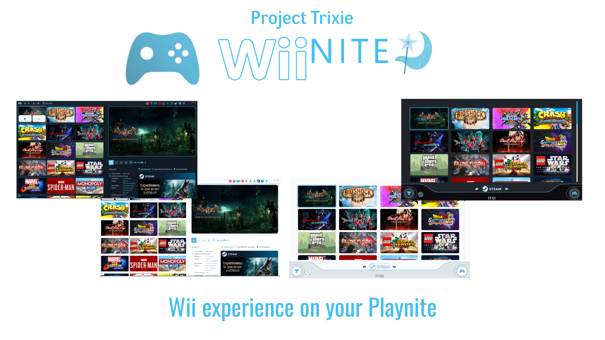
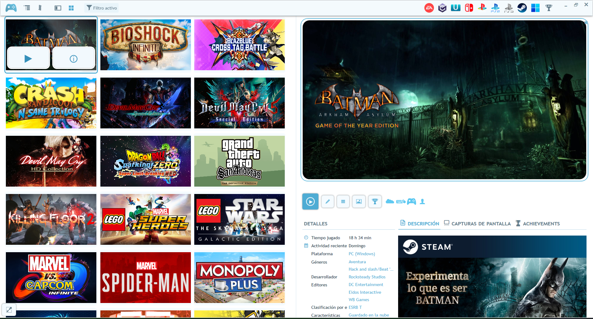
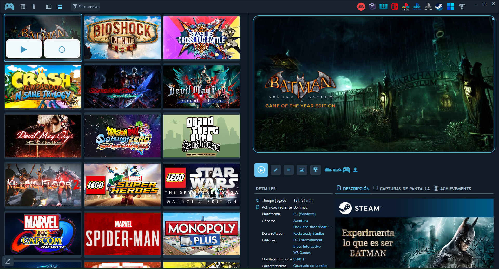
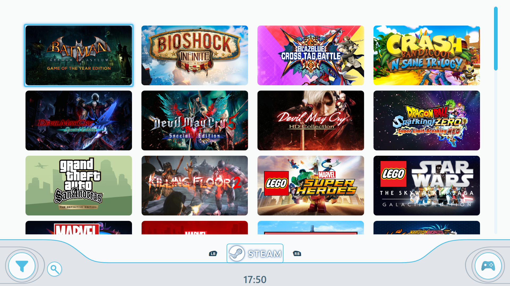
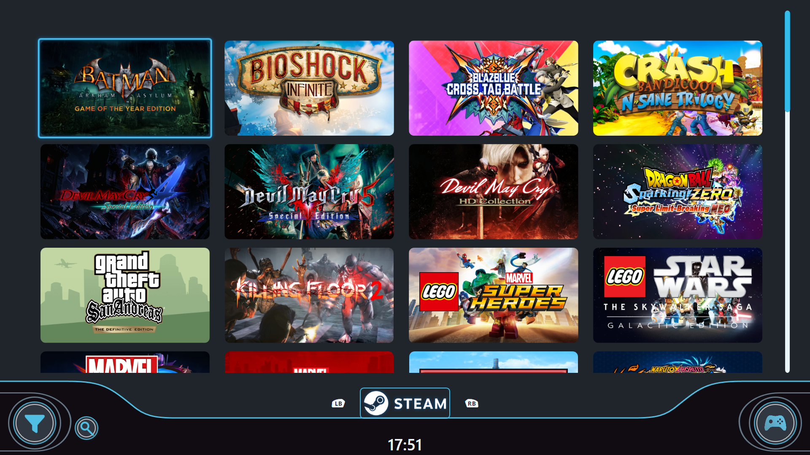
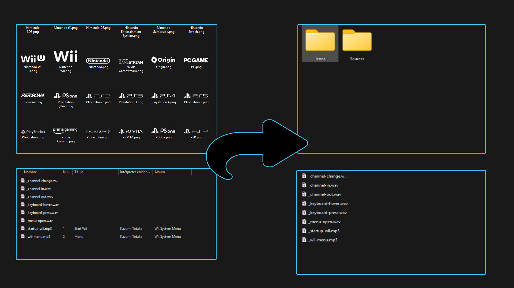
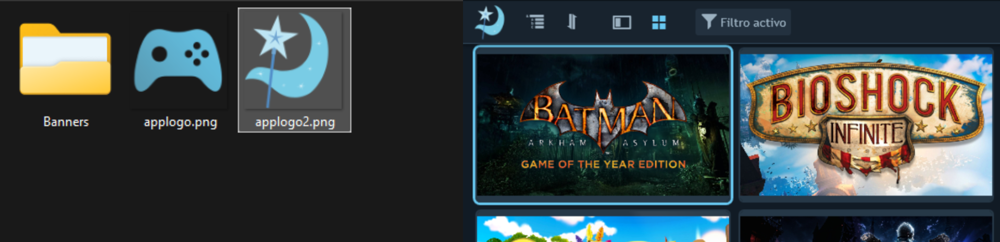

# Project Trixie — WiiNite

**A Wii-inspired collection of Desktop and Fullscreen themes for [Playnite](https://playnite.link/).**

Project Trixie brings a Wii-inspired interface to your game library, with **four editions** across Playnite's Desktop and Fullscreen modes. Choose a light or dark appearance, and make it your own with **BYOA (Bring Your Own Assets)** customization.

> **Version:** 1.0.0 · **Author:** NEGAARMAX · **Unofficial fan-made project**

## Choose your edition

| Desktop — Light | Desktop — Dark |
|:---:|:---:|
|  |  |

| Fullscreen — Original | Fullscreen — Dark |
|:---:|:---:|
|  |  |

All four editions have separate theme identifiers, so you can install both color variants of a mode and switch between them in Playnite.

## Features

### Desktop — Wii Channel

- Wii-inspired library presentation, game backgrounds, and themed play/info controls.
- Light and Dark editions with distinct color schemes.
- Grid and game-details views adapted from KNARZnite.
- Optional integration with **Moondancer Media Manager** for compatible artwork presentation.
- Support for **Extra Metadata Loader** game logos, **ThemeModifier** settings, **ThemeExtras** library banners, and **LibraryManagement** integration.
- BYOA-friendly banner folders so you can supply your own library graphics.
- Two included sidebar/top-panel icon options, plus support for a custom replacement image.

### Fullscreen — WiiNite

- Wii-inspired Fullscreen interface, controls, and game views.
- Original and Dark editions.
- BYOA icon directories for your own authorized platform and game artwork.
- Placeholder audio files that can be replaced with compatible sounds you own or are authorized to use.
- Game artwork can be supplied by your Playnite library and compatible extensions.

## Bring Your Own Assets (BYOA)

The public packages are intentionally different from the author's personal setup. **Original Nintendo Wii menu audio, collected game/platform icon packs, and personal artwork are not distributed.** Add your own assets, or assets you have permission to use.

| 1. Default BYOA appearance | 2. Add your own assets | 3. Customized result |
|:---:|:---:|:---:|
|  |  |  |

### Fullscreen assets

The Fullscreen packages contain the following directories for user-supplied icon resources:

```text
Icons/Icons/Archive/
Icons/Icons/Squared/
Icons/Sources/
```

Keep the paths and filenames expected by the theme. If icons have not been supplied, some libraries may appear as text instead.

The `audio/` directory contains six WAV and two MP3 placeholder files:

```text
_channel-change.wav
_channel-in.wav
_channel-out.wav
_keyboard-hover.wav
_keyboard-press.wav
_menu-open.wav
_startup-wii.mp3
_wii-menu.mp3
```

To replace them, use audio you are permitted to use, preserve the filenames and extensions, and ensure the replacement files have compatible audio formats. Back up the original placeholders first. **The packages do not include original Wii sound recordings.**

### Desktop: choose or customize the theme icon

**Desktop editions only.** The Desktop theme includes two icon images: `Images/applogo.png` (the default blue Playnite controller logo) and `Images/applogo2.png` (the alternative Trixie cutie mark).

The interface references `Images/applogo.png`. To use the alternative, back up the original `applogo.png`, then rename or copy `applogo2.png` to `applogo.png`. You can also replace `applogo.png` with your own artwork. Restart or reload the theme if the image does not update immediately.



*This is a file-based customization, not an in-app icon selector; it does not apply to the Fullscreen editions.*

## Installation

1. Download the `.pthm` file for the edition you want from the [GitHub Releases](../../releases) page.
2. Install the theme through Playnite's theme installation workflow.
3. In Playnite's appearance settings, select the installed theme under **Desktop** or **Fullscreen**, as appropriate.
4. Configure any optional extensions you use, and add your own BYOA resources if desired.

Desktop and Fullscreen are separate Playnite modes. Installing a theme for one mode does not replace the other.

## Optional extensions and integrations

The Desktop edition retains integration points for:

- **[Moondancer Media Manager](https://github.com/NEGAARMAX/Moondancer-Media-Manager)** — customizable artwork display in supported themes.
- **[Extra Metadata Loader](https://github.com/darklinkpower/PlayniteExtensionsCollection)** — game logo metadata; part of darklinkpower’s Playnite Extensions Collection.
- **[ThemeModifier](https://github.com/Lacro59/playnite-thememodifier-plugin)** — configurable theme constants.
- **[ThemeExtras](https://github.com/felixkmh/ThemeExtras-for-Playnite)** — library banners and related resources.
- **[LibraryManagement](https://github.com/Lacro59/playnite-librarymanagement-plugin)** — additional library management integration.

These extensions are **not bundled** with Project Trixie. Their availability and setup depend on your Playnite installation. Some visual elements or options may be unavailable without the corresponding extension.

## Source code and project structure

The repository is intended to contain the four theme sources in separate folders:

```text
Desktop/
  Light/
  Dark/
Fullscreen/
  Original/
  Dark/
screenshots/
README.md
CHANGELOG.md
THIRD-PARTY-NOTICES.md
LICENSE
```

The four installable `.pthm` files are distributed separately through GitHub Releases. The directory layout above describes the **planned public repository organization**, not a claim that it has already been uploaded.

## Credits and acknowledgments

Project Trixie was adapted and customized by **NEGAARMAX**. Special thanks to the creators and maintainers of the projects that informed its development:

- **KNARZnite** — Alexander Heidn (HerrKnarz): [original Desktop theme](https://github.com/HerrKnarz/Playnite-Theme-KNARZnite).
- **Harmony** — darklinkpower: [repository](https://github.com/darklinkpower/Harmony); acknowledged among KNARZnite's upstream influences.
- **DH_Dawn / DH_Themes** — felixkmh: [repository](https://github.com/felixkmh/DH_Themes); acknowledged among KNARZnite's upstream influences.
- **Duk FST** — dukobpa3: [repository](https://github.com/dukobpa3/Duk_FST_Packed_0); Fullscreen code and implementation reference.
- **ReskinXBOXSX** — TheKersalMassive: [repository](https://github.com/TheKersalMassive/ReskinXBOXSX); upstream project acknowledged by Duk FST.
- **Playnite** and its community of theme and extension developers.

Please see `THIRD-PARTY-NOTICES.md` and the included license files for detailed copyright and licensing information. Some upstream code is distributed under MIT; that does not automatically establish rights to third-party artwork, logos, fonts, or sounds. ReskinXBOXSX's public repository did not identify an explicit redistribution license during our review, and the provenance of some inherited material and placeholder audio still requires confirmation before release.

## Legal notice

Project Trixie — WiiNite is an **unofficial fan project**, not affiliated with, sponsored by, or endorsed by Playnite, Nintendo, Hasbro, or the creators of the referenced themes. Playnite branding, Wii-inspired visual elements, and the Trixie cutie mark remain subject to their respective owners' rights. BYOA does not grant permission to obtain or redistribute copyrighted assets.

## 🎬 Video Showcase

Take a look at Project Trixie — WiiNite in action!

[](https://www.youtube.com/watch?v=zDSUBqLgC10)

*Experience the magic of the Great and Powerful Trixie!*

## A little message from The Great and Powerful Trixie! 🎩✨

> *The Great and Powerful Trixie went through over 300 beta versions to bring you this magnificent theme! A little thank you would be appreciated.*
>
> — The Great and Powerful Trixie, probably.
